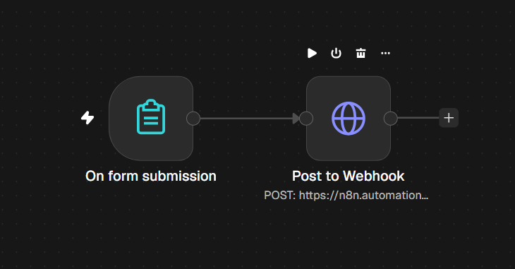
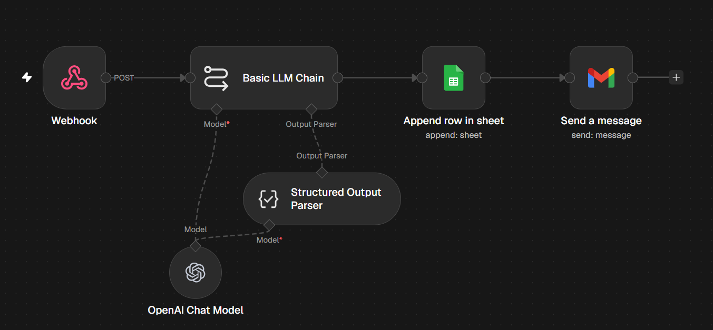
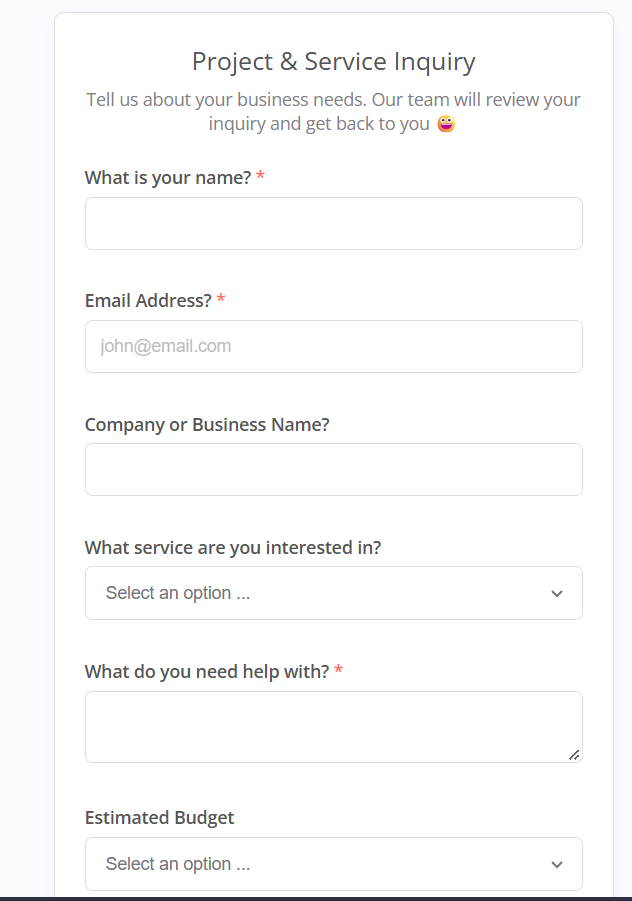

# LeadFlow – AI Lead Qualification & Response Automation

LeadFlow is an n8n automation project that simulates how a business can handle incoming inquiries using AI. It processes submitted lead information, records inquiries in Google Sheets, and sends automated email responses.

**Try the live form:** [Submit an Inquiry](https://n8n.automationabc.com/form/LeadFLow)

## Workflows Overview

## Inquiry Form

## Problem It Solves

Businesses often receive inquiries that require manual review, recordkeeping, and follow-up. Handling these tasks individually can delay responses, create inconsistent communication, and cause potential leads to be overlooked.

LeadFlow demonstrates how these repetitive tasks can be automated through an AI-powered workflow, helping businesses process inquiries consistently and maintain organized lead records.

## Workflow

1. **Lead Submission** – An n8n form collects the inquirer's information and inquiry details.
2. **Webhook Integration** – An HTTP Request node sends the form data to a separate n8n webhook, simulating an external application submitting a lead through an API endpoint.
3. **AI Processing** – The webhook workflow uses an AI model guided by a system prompt to process the submitted information.
4. **Lead Recording** – The inquiry is appended to Google Sheets for centralized recordkeeping.
5. **Automated Email Response** – An email is sent to the inquirer, completing the workflow.

## Tech Stack

- **n8n** – Workflow orchestration, form handling, webhooks, and automation logic.
- **AI / LLM** – AI-powered processing of inquiry information.
- **Google Sheets** – Lead and inquiry recordkeeping.
- **Email Integration** – Automated email responses.
- **HTTP Request & Webhook** – API-style communication between the form workflow and the lead-processing workflow.

## Key Features

- Automated inquiry intake.
- AI-assisted inquiry processing.
- Centralized lead recordkeeping.
- Automated email responses.
- Modular workflows simulating real-world API integration.

## Project Goal

Demonstrate practical skills in AI-powered automation, API integration, workflow orchestration, and connecting external services to build a reusable lead-handling solution.